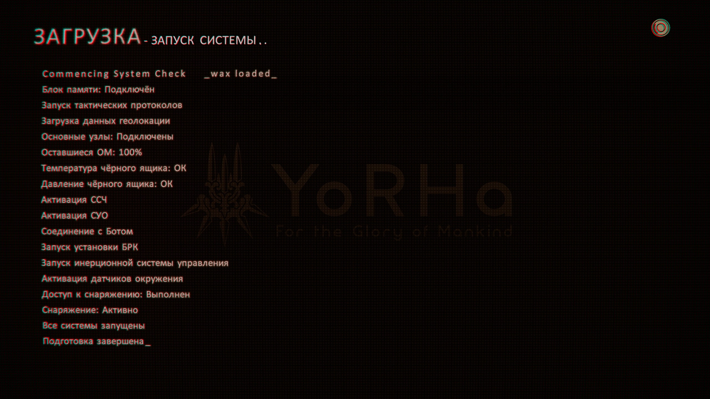
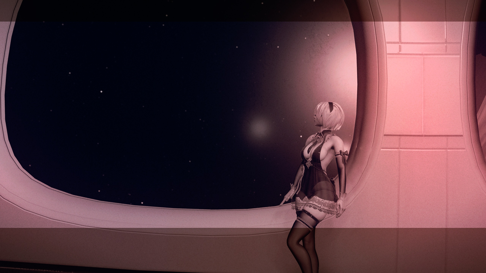
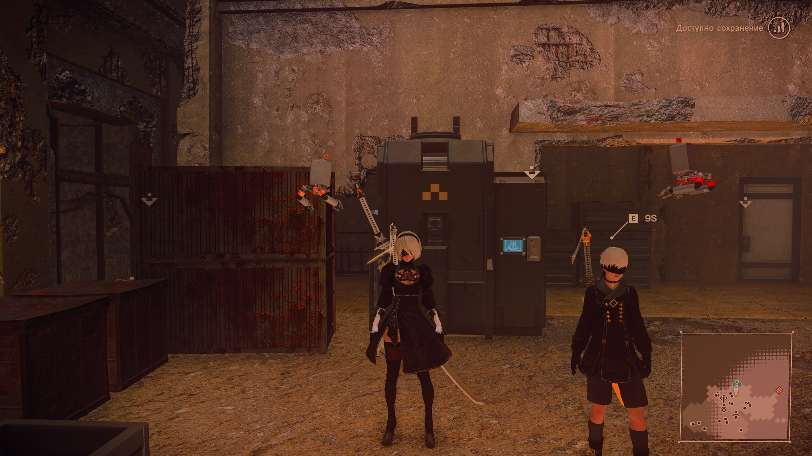
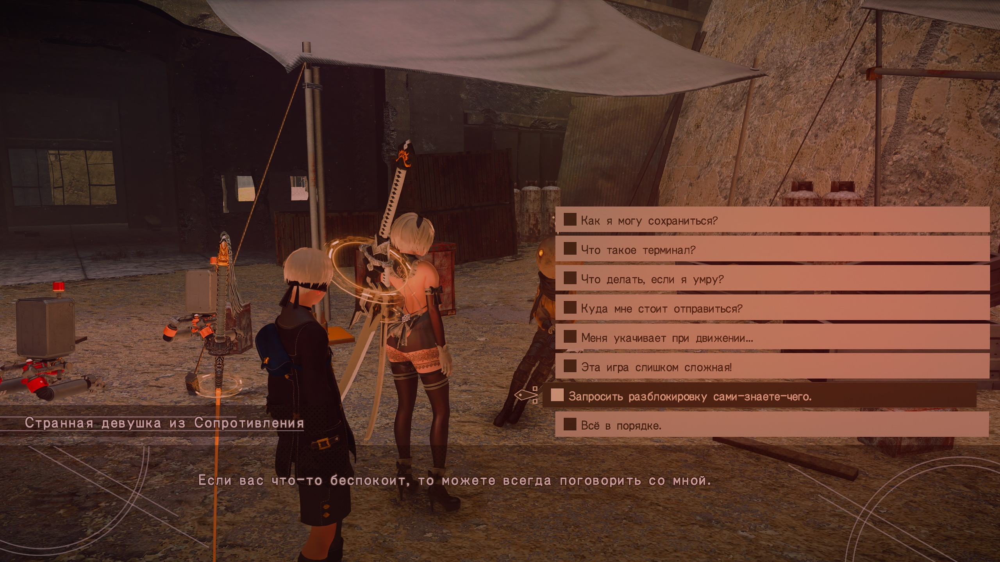
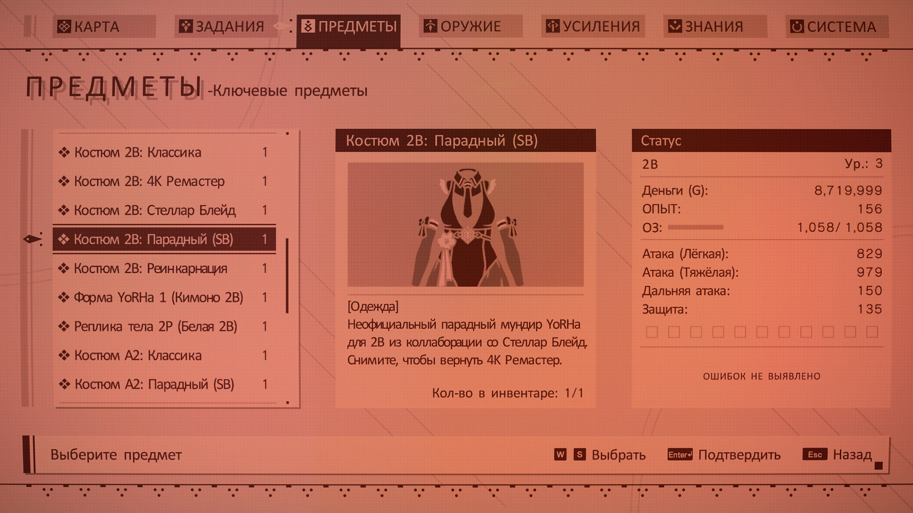
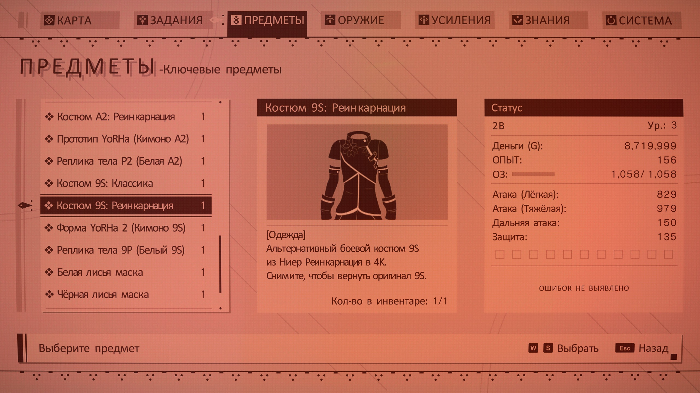
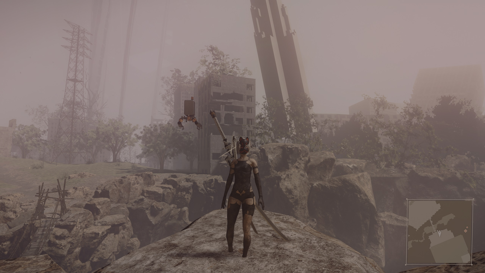

# NieR:Automata — Ultimate ModPack (2026 Edition)



> **Комплексное техническое и графическое переиздание ПК-версии *NieR:Automata* с автоматической установкой в 1 клик (`Install_NieR_Mods.bat`), полной русской локализацией в 4K и интерактивным менеджером модулей (`Toggle_Mods.bat`).**

[-2ea043?style=for-the-badge&logo=bittorrent)](https://github.com/IlkaPi/NieR-Automata-Ultimate-ModPack/releases/latest/download/NieR_Automata_Ultimate_ModPack_2026.torrent)
[-e34c26?style=for-the-badge&logo=youtube)](https://github.com/IlkaPi/NieR-Automata-Ultimate-ModPack/releases/latest/download/Gameplay_Preview_Prologue_60FPS.mp4)
[-5391FE?style=for-the-badge&logo=powershell)](scripts_preview/)

---

## Скачать сборку (BitTorrent / Magnet)

* **Файл раздачи (`.torrent`):** [**NieR_Automata_Ultimate_ModPack_2026.torrent**](https://github.com/IlkaPi/NieR-Automata_Ultimate_ModPack/releases/latest/download/NieR_Automata_Ultimate_ModPack_2026.torrent) *(434 КБ — [прямое зеркало из репозитория](https://github.com/IlkaPi/NieR-Automata-Ultimate-ModPack/raw/main/NieR_Automata_Ultimate_ModPack_2026.torrent))*
* **Видео-превью (геймплей пролога + переход в 2K 60 FPS катсцену появления 2B):** [**Gameplay_Preview_Prologue_60FPS.mp4**](https://github.com/IlkaPi/NieR-Automata-Ultimate-ModPack/releases/latest/download/Gameplay_Preview_Prologue_60FPS.mp4) *(252 МБ)*
* **Объём дистрибутива:** **58.94 ГБ** (`63 289 735 980` байт, `3 480` файлов — поставляется готовой папкой без архивации)
* **InfoHash (SHA-1):** `0f5449d15e0b0d702dd1feba1807a167348ee7e5`

<details>
<summary><b>Нажмите, чтобы скопировать Magnet-ссылку напрямую</b></summary>

```text
magnet:?xt=urn:btih:0f5449d15e0b0d702dd1feba1807a167348ee7e5&dn=NieR_Automata_Ultimate_ModPack&tr=udp%3A%2F%2Ftracker.opentrackr.org%3A1337%2Fannounce&tr=udp%3A%2F%2Fopen.stealth.si%3A80%2Fannounce&tr=udp%3A%2F%2Ftracker.torrent.eu.org%3A451%2Fannounce&tr=udp%3A%2F%2Fopen.demonii.com%3A1337%2Fannounce&tr=udp%3A%2F%2Fexodus.desync.com%3A6969%2Fannounce&tr=udp%3A%2F%2Fopen.tracker.cl%3A1337%2Fannounce&tr=udp%3A%2F%2Ftracker.qu.ax%3A6969%2Fannounce&tr=udp%3A%2F%2Ftracker.ducks.party%3A1984%2Fannounce&tr=udp%3A%2F%2Ftracker.bittor.pw%3A1337%2Fannounce&tr=udp%3A%2F%2Ftracker.nyaa.vc%3A6969%2Fannounce&tr=udp%3A%2F%2Ftracker-udp.gbitt.info%3A80%2Fannounce&tr=udp%3A%2F%2Fexplodie.org%3A6969%2Fannounce&tr=udp%3A%2F%2Fretracker01-msk-virt.corbina.net%3A80%2Fannounce&tr=http%3A%2F%2Fretracker.local%2Fannounce&tr=http%3A%2F%2Ftracker2.dler.org%3A80%2Fannounce&tr=http%3A%2F%2Ftracker.dler.org%3A6969%2Fannounce&tr=http%3A%2F%2Ftracker.renfei.net%3A8080%2Fannounce
```

</details>

> [!TIP]
> **Интеллектуальная установка в 0 ГБ лишнего места:** качайте папку сборки **на тот же NTFS-диск**, где установлена *NieR:Automata* в Steam. Установщик `Install_NieR_Mods.bat` автоматически свяжет 54 ГБ текстур и видеороликов через **жёсткие ссылки NTFS** за несколько секунд — без дублирования места на диске и **без прерывания раздачи в торрент-клиенте**!

---

## Скриншоты из сборки

| Бункер YoRHa (Образ Stellar Blade `#776`) | Лагерь Сопротивления (4K текстуры + ReShade + маркеры) |
| :---: | :---: |
|  |  |
| **Полная русская локализация диалогов и 4K UI** | **Инвентарь гардероба (Часть 1: 2B -> A2)** |
|  |  |
| **Инвентарь гардероба (Часть 2: A2 -> 9S -> Аксессуары)** | **Нюанс с лисьими масками Switch DLC на 2B и A2** |
|  |  |

> [!NOTE]
> **Честный нюанс по лисьим маскам из Switch DLC:** модели масок (*Белая* и *Чёрная лисья маска*) плохо работают с волосами 2B и A2 вообще (пряди и чёлка проходят сквозь текстуру маски, как на скриншоте выше), поэтому нормально эти две маски выглядят по сути только на **9S**. Заколки (*Лунный свет* и *Цветок памяти*) отлично сидят на всех.

---

## 1. Общие характеристики и структура объёма

Сборка устраняет архитектурные ограничения оригинального порта, обновляет текстуры мира, персонажей и все 150 видеороликов до стандартов 2K/4K 60 FPS, исправляет управление мышью и включает полную русскую локализацию с расширенным гардеробом образов без единой ошибки хеш-таблиц `.dat`/`.dtt` и без потери достижений Steam.

* **Всего модификаций и технических патчей:** **25** (`7` модулей базового ядра + `18` переключаемых модулей)
* **Интегрированный гардероб:** **19 костюмов** (`8` для 2B, `6` для A2, `5` для 9S) + **4 аксессуара** из издания *The End of YoRHa Edition*
* **Общее количество файлов дистрибутива:** **3 480 файлов**
* **Итоговый объём сборки:** **58.94 ГБ** (`63 289 735 980` байт)

| Компонент сборки | Объём | Доля |
| :--- | :---: | :---: |
| Глобальный пакет 4K AI-текстур окружения (`#794` — 2 301 текстура `.dds`) | **30.84 ГБ** | 52.3% |
| Сюжетные видеоролики в 2K (1440p) 60 FPS H.264 (`#688` — 150 катсцен + 4K заставки) | **23.15 ГБ** | 39.3% |
| Пакет текстур архитектуры и ключевых объектов GPUnity V1.03 (`#5`) | **1.96 ГБ** | 3.3% |
| Пакеты костюмов 2B / A2 / 9S, аксессуары и доработанные анимации | **1.61 ГБ** | 2.7% |
| Модификации игрового мира (снятие невидимых стен, растительность, песок, 3D-карты) | **0.68 ГБ** | 1.2% |
| 4K Ремастер базовых моделей главных героев (`2B / A2 / 9S`) | **0.23 ГБ** | 0.4% |
| 4K Ремастер моделей Подов 042 и 153 | **0.23 ГБ** | 0.4% |
| Системное ядро (Special K, WAX, HighFPS, LodMod, DLAA, ReShade, NAIOM, резерв `.exe`) | **0.16 ГБ** | 0.3% |
| Полная русская локализация текста, новелл и 4K-интерфейса | **0.09 ГБ** | 0.1% |
| **ИТОГО** | **58.94 ГБ** | **100%** |

---

## 2. Базовое ядро сборки (7 системных модулей)

1. **Special K / FAR v23.6.9.1 (`dxgi.dll`)** — базовый графический фреймворк и загрузчик плагинов: корректный безрамочный режим, HDR и потоковая инжекция 4K-текстур из `SK_Res`.
2. **WAX v0.3.0 Limit Break (`wax.dll` — модифицированная сборка)** — снимает штатное ограничение памяти движка (*Heap Overflow Allocator*), предотвращая вылеты на высокополигональных моделях, и реализует независимые слоты одежды с фиксированной сортировкой предметов в инвентаре (`2B -> A2 -> 9S -> Аксессуары`).
3. **NAIOM (`dinput8.dll` + `NAIOM-GUI.exe`)** — прямой *Raw Input* камеры мыши без сглаживания и акселерации, прицеливание по курсору в изометрических и полётных режимах, выделенные клавиши уклонения и авто-стрельбы Пода, курсор YoRHa.
4. **Полная русская локализация текста, новелл и 4K UI (`ru_fix`)** — перевод сюжетных и побочных заданий, архивов, историй оружия, текстовых новелл и 4K-интерфейса с сохранением оригинального пролога.
5. **GPUnity's Texture Pack V1.03 (`1.96 ГБ`)** — ручная реставрация уникальных сюжетных текстур, вывесок и фасадов.
6. **Androids Remastered 4K `#30` (`235 МБ`)** — 4K-текстуры кожи, лиц, глаз, волос и стандартного снаряжения 2B, A2 и 9S.
7. **Main Menu HD + 4K Boot Logos + Контроль совместимости EXE** — 4K-экран главного меню, 4K-логотипы запуска и автоматическая проверка совместимого исполняемого файла (`build 7020666`).

> [!NOTE]
> В менеджере `Toggle_Mods.bat` предусмотрена сервисная команда **`R`**, которая за один шаг полностью возвращает игру к чистому заводскому состоянию Steam.

---

## 3. Переключаемые модули (18 модификаций в `Toggle_Mods.bat`)

Любой из **18 модулей** включается или отключается нажатием его номера (`1–18`) в `Toggle_Mods.bat`:

| № | По умолч. | Модуль | Описание |
| :---: | :---: | :--- | :--- |
| **1** | **ВКЛ** | **Гардероб 2B (8 образов в 1)** | 4K-ремастер базы + 7 отдельных костюмов в инвентаре: *Классика 2017*, два образа кроссовера *Stellar Blade* (`#776` и Парадный `#749` с выверенной физикой ткани и костей), *NieR Re[in]carnation*, *4K 2BBE*, *Кимоно* и *Реплика 2P*. |
| **2** | **ВКЛ** | **Гардероб A2 (6-в-1) + 9S (5-в-1) + Аксессуары** | 4K-ремастеры баз, образы *Stellar Blade* (A2), *Re[in]carnation* (A2/9S), *Кимоно* (A2/9S), *P2 / 9P*, плюс 4 аксессуара (*Белая и Чёрная лисьи маски* — лучше всего сидят на 9S, заколки *Лунный свет* и *Цветок памяти*). |
| **3** | **ВЫКЛ** | **Цветной Бункер YoRHa (Bunker in Color 2.0)** | Заменяет Ч/Б фильтр орбитальной базы YoRHa на цветное освещение. Отключён по умолчанию ради сохранения оригинальной режиссуры (включается цифрой `3`). |
| **4** | **ВКЛ** | **Удаление экранной сетки и виньетки** | Убирает пиксельную сетку поверх кадра и мыло по краям экрана. |
| **5** | **ВКЛ** | **Густая растительность (`#657`) + 3D Лунная Слеза (`#558`)** | Увеличивает плотность травы и заменяет плоский спрайт цветка Лунной Слезы на честную 3D-модель. |
| **6** | **ВКЛ** | **HD-следы на песке (Sand Steps HD)** | Рельефные HD-отпечатки следов в Пустыне без парения над землёй. |
| **7** | **ВКЛ** | **Полная 3D-карта Парка Развлечений** | Дополняет 3D-карту скрытыми переходами, лестницами и подземными уровнями. |
| **8** | **ВКЛ** | **Цветокоррекция ReShade (`NieR Fantasy`)** | Сбалансированный профиль глубины теней и полутонов с сохранением авторской палитры. |
| **9** | **ВКЛ** | **Отзывчивость боя (`#582`) + Живой взгляд (`#771`)** | Ускоряет отмену анимаций уклонением, делает подхват Пода мгновенным и добавляет живое моргание глаз для 2B и A2. |
| **10** | **ВКЛ** | **Отключение перезарядки скиллов Пода (`#651`)** | Убирает кулдаун программ Пода (для возврата стандартного баланса отключается цифрой `10`). |
| **11** | **ВКЛ** | **AutomataHighFPS v0.2.0 (Быстрые загрузки + 60/120+ FPS)** | Ускоряет загрузки и синхронизирует физику ткани. По умолчанию выставлен эталон `60 FPS` без микродрожи юбок (`TargetFPS` меняется в `AutomataHighFPS.ini`). |
| **12** | **ВКЛ** | **Automata LodMod v0.77.4 + Fix `#675`** | Убирает подгрузку упрощённых моделей вблизи камеры (*LOD pop-in*), включает 4K-тени и *HD Ambient Occlusion*. |
| **13** | **ВКЛ** | **NVIDIA DLAA 1.1 / DLSS 4 Transformer (`#826`)** | Нейросетевое сглаживание на базе трансформер-модели DLSS 4 — полностью убирает лесенки и мерцание тонких объектов. |
| **14** | **ВКЛ** | **Pods 4K Remastered (`#30`)** | 4K-текстуры корпусов и механизмов Подов 042 и 153. |
| **15** | **ВКЛ** | **Открытый мир без невидимых стен (Free Roam `#322`)** | Снимает невидимые барьеры на крышах, скалах и границах локаций. |
| **16** | **ВКЛ** | **Контрастные маркеры сундуков + 4K RU UI** | Выделяет закрытые сундуки красными иконками на карте с полным сохранением 4K русского интерфейса. |
| **17** | **ВКЛ** | **Глобальный пакет 4K AI-текстур мира (`#794`)** | Обновление `2 301` текстуры ландшафта, архитектуры, техники и интерьеров (`30.84 ГБ`). |
| **18** | **ВКЛ** | **Сюжетные катсцены в 2K (1440p) 60 FPS (`#688`)** | Замена всех 150 пререндеренных роликов (в оригинале 900p / 30 FPS) на плавные 1440p / 60 FPS (`23.15 ГБ`). |

> [!IMPORTANT]
> **Аппаратное требование модуля №13 (NVIDIA DLAA):** плагин работает на видеокартах **NVIDIA GeForce RTX (2000 / 3000 / 4000 / 5000)**. На системах с **AMD Radeon** или **NVIDIA GTX 10xx / 16xx** перед первым запуском откройте `Toggle_Mods.bat` и введите **`13`** для отключения DLAA. На картах RTX оставьте включённым параметр *«Размытие в движении»* в настройках самой игры (само размытие при этом автоматически скрывается плагином для передачи векторов движения).

---

## 4. Горячие клавиши и управление

### Системные хоткеи в игре
| Клавиша | Назначение |
| :---: | :--- |
| **`Home`** | Панель постобработки **ReShade** (`NieR Fantasy`) |
| **`Ctrl + Shift + Backspace`** | Меню **Special K / FAR** (мониторинг, окно, HDR) |
| **`F10`** | Вкл / выкл сглаживание **NVIDIA DLAA** на лету |
| **`F9`** | Стоп-кадр игрового мира (**WAX Freeze** — фотопауза для скриншотов) |
| **`PrintScreen`** | Сохранить скриншот в папку игры *(при игре с HDR лучше снимать через Xbox Game Bar `Win + Alt + PrtScn`)* |
| **`-`** *(минус)* | Горячая перезагрузка настроек управления `NAIOM` без выхода из игры |

### Управление (Геймпад и Клавиатура + Мышь)
* **Контроллер (Xbox / DualSense / DualShock):** автоматически использует родную консольную раскладку и подсказки (`NAIOM` не перехватывает геймпад).
* **Клавиатура и мышь (`NAIOM`):** `ЛКМ` — лёгкая атака, `ПКМ` — тяжёлая атака, **`Left Alt`** — мгновенное уклонение в одно нажатие, **`Left Shift`** — переключатель непрерывного авто-огня Пода, `F` — программа Пода, `1` — смена сета оружия, `2`/`3` — выбор программы Пода, `6`/`7` и `H` — выбор и применение предметов. Переназначить любые клавиши и чувствительность мыши можно через утилиту **`NAIOM-GUI.exe`** в папке игры.

---

## 5. Установка в 1 клик

1. Установите чистую лицензионную версию **NieR:Automata** в Steam *(рекомендуется один раз запустить до главного меню и закрыть игру)*.
2. Скачайте папку **`NieR_Automata_Ultimate_ModPack`** через [`.torrent`-файл](https://github.com/IlkaPi/NieR-Automata-Ultimate-ModPack/releases/latest/download/NieR_Automata_Ultimate_ModPack_2026.torrent) *(желательно на тот же NTFS-диск, где установлена игра)*.
3. Запустите **`Install_NieR_Mods.bat`** *(в окне Windows SmartScreen нажмите «Подробнее» -> «Выполнить в любом случае»)*.
4. Дождитесь завершения проверки целостности всех 25 узлов (`УСПЕШНО! Все моды установлены и настроены!`) и запускайте игру кнопкой **«ИГРАТЬ»** в Steam!

---

## 6. Авторы модификаций и прямые ссылки на первоисточники (Credits)

Сборка не присваивает чужой труд, а объединяет, синхронизирует и исправляет конфликты между лучшими работами моддинг-сообщества **NieR:Automata**. Огромная благодарность авторам оригинальных инструментов и модификаций (если вам понравилась сборка — обязательно зайдите по ссылкам и поставьте *Endorse* авторам на NexusMods):

* **Сборка дистрибутива, интеграция модулей, исправление коллизий архивов/физики и авто-инсталлятор:** **[IlkaPi](https://github.com/IlkaPi)**
* **[Special K / FAR (Fix Automata Resolution)](https://github.com/Kaldaien/FAR)** — *Kaldaien*
* **[WAX — Wolf's Automata eXpansion (#744)](https://www.nexusmods.com/nierautomata/mods/744)** — *Woeful_Wolf* *(с кастомным патчем фиксированной сортировки инвентаря и Limit Break)*
* **[NAIOM — NieR:Automata Input Overhaul Mod (#12)](https://www.nexusmods.com/nierautomata/mods/12)** — *Methanhydrat*
* **[GPUnity's Texture Pack (#5)](https://www.nexusmods.com/nierautomata/mods/5)** — *GPUnity*
* **[Automata-LodMod (#29)](https://www.nexusmods.com/nierautomata/mods/29)** (*emoose*) + **[Automata LodMod Fix v0.3 (#675)](https://www.nexusmods.com/nierautomata/mods/675)**
* **[DLSS Anti-Aliasing / NVIDIA DLAA (#826)](https://www.nexusmods.com/nierautomata/mods/826)** — *инжектор DLAA / DLSS 4 Transformer*
* **[4K AI Textures RePacked (#794)](https://www.nexusmods.com/nierautomata/mods/794)** — *на базе 4K текстур от Evgeshajk*
* **[1440p 60 FPS H.264 Story Cutscenes (#688)](https://www.nexusmods.com/nierautomata/mods/688)** — *апскейл 150 сюжетных видеороликов*
* **[Androids & Pods 4K Remastered (#30)](https://www.nexusmods.com/nierautomata/mods/30)** — *4K ремастер базовых моделей 2B, A2, 9S и Подов*
* **[2B Stellar Blade Edition (#776)](https://www.nexusmods.com/nierautomata/mods/776)** — *костюм кроссовера Stellar Blade*
* **[YoRHa Unofficial Ceremonial Attire — 2B & A2 (#749)](https://www.nexusmods.com/nierautomata/mods/749)** — *парадная форма для 2B и A2*
* **Костюмы NieR Re[in]carnation (WAX):** **[A2 (#162)](https://www.nexusmods.com/nierautomata/mods/162)** | **[2B (#168)](https://www.nexusmods.com/nierautomata/mods/168)** | **[9S (#209)](https://www.nexusmods.com/nierautomata/mods/209)**
* **[Kimono Outfits & Switch DLC Accessories (#812)](https://www.nexusmods.com/nierautomata/mods/812)** — *кимоно и аксессуары издания The End of YoRHa*
* **[Free Roam — Complete Map Collision Rework (#322)](https://www.nexusmods.com/nierautomata/mods/322)** — *мир без невидимых стен*
* **[Denser Grass (#657)](https://www.nexusmods.com/nierautomata/mods/657)** (*Seek877*) + **[Lunar Tear 3D Fix (#558)](https://www.nexusmods.com/nierautomata/mods/558)**
* **[Gameplay Changes / Animation Swap (#582)](https://www.nexusmods.com/nierautomata/mods/582)** + **[Blinking Animations for 2B & A2 (#771)](https://www.nexusmods.com/nierautomata/mods/771)** + **[No Pod Cooldown (#651)](https://www.nexusmods.com/nierautomata/mods/651)**
* **Bunker in Color & Hidden Amusement Park Map Unlock** (*RaiderBV*), **Sand Footsteps Remastered** (*Takahama & Kekoulis*), **AutomataHighFPS v0.2.0**
* **Русская локализация текста и 4K UI:** порт официального перевода *The End of YoRHa Edition* (*Rigonda*) и наработки сообщества русификации (*The Miracle / Rindera*)

> Все права на оригинальную игру **NieR:Automata** принадлежат **Square Enix** и **PlatinumGames Inc.** Сборка распространяется бесплатно в некоммерческих целях и требует установленной базовой игры.
